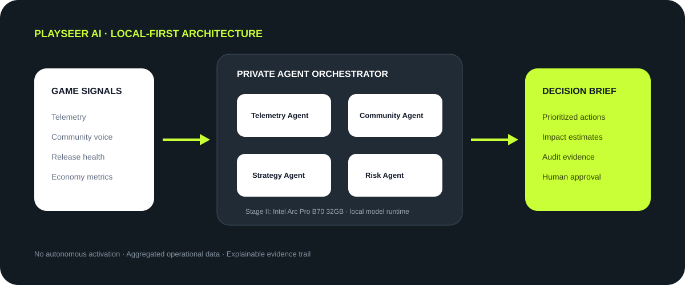

# PlaySeer AI

**A private Workplace AI decision desk for game LiveOps teams.** PlaySeer turns aggregated retention, monetization, community sentiment and release-health signals into an evidence-backed response plan. Four specialist agents can run in parallel against an OpenAI-compatible local inference service; a deterministic policy baseline keeps the MVP reproducible when no model endpoint is available. Every recommendation requires human review before activation.



## ASUS UGen AI League positioning

- **Theme:** Workplace AI. The workplace is the LiveOps operation room, where producers, analysts, community leads and release teams coordinate responses to player-impacting incidents.
- **Battlefield:** Battlefield Thunderstorm — High-Performance Development, targeting the ASUS UGen Intel Arc Pro B70 32GB platform.
- **Problem:** Cross-functional game operations signals are fragmented. Teams need a fast, explainable and privacy-preserving way to agree on a reversible response.
- **Core value:** Turn aggregated operational signals into ranked interventions, segment watchlists and an auditable decision brief without sending data to a public inference API.

This repository is a software MVP, not a claim of ASUS hardware integration. With no local model configured it uses a deterministic rule-based baseline. The UI labels the inference source and reports hardware validation as pending. Thunderstorm final submissions must demonstrate operation and validation on the organizer-provided virtual environment or SDV system. Performance and model-quality results from that environment must be measured there; this repository does not invent those results.

## MVP capabilities

- Three LiveOps scenarios: season launch, monetization backlash and stability incident.
- Editable DAU, retention, conversion, sentiment and crash-rate inputs with range validation.
- Four specialists—Telemetry, Community, Strategy and Risk—that run concurrently against a configured local model.
- Prioritized actions, segment watchlist, agent evidence, a human approval gate and an audit trail.
- Local run history and downloadable JSON decision report.
- Deterministic fallback mode when the local inference endpoint is not configured or unavailable.
- No third-party package dependencies; model API credentials remain server-side.

## Run locally

Node.js 18 or newer is recommended. No package installation is required.

```bash
npm start
```

Open <http://localhost:4173>. For the fully reproducible offline demo, leave the local model variables unset. The API endpoints are `GET /api/runtime` and `POST /api/analyze`.

### Connect an OpenAI-compatible local model

Point the Node server at an OpenAI-compatible local inference service such as the organizer-provided runtime when available. Set the base URL to the service's `/v1` endpoint and the model identifier exposed by that runtime. An API key is optional and is read only by the server process.

```bash
LOCAL_AI_BASE_URL=http://127.0.0.1:8000/v1 \
LOCAL_AI_MODEL=your-local-model \
LOCAL_AI_API_KEY=optional-local-token \
npm start
```

The server sends four parallel chat-completion requests and asks for structured JSON. If one or more requests fail or return malformed JSON, the entire analysis safely falls back to the deterministic baseline and labels the result. Do not expose a model API key in the browser or commit it to this repository. On Windows PowerShell, set environment variables with `$env:LOCAL_AI_BASE_URL=...` before running `npm start`.

## Test

```bash
npm test
```

Tests cover the deterministic decision policy, invalid metrics and parallel local-agent structured responses. The model test uses a stubbed endpoint; it does not measure a real model or GPU.

## Stage II validation still required

When access is provided, configure `LOCAL_AI_BASE_URL` and `LOCAL_AI_MODEL` in the organizer's approved VM/SDV environment, run the demo there, and collect evidence for actual model/runtime identity, end-to-end and per-agent latency, sequential versus parallel throughput, structured-output adherence, baseline-versus-model quality, and reproducible logs. Record the software and driver/runtime versions. Do not describe Sandbox or laptop runs as Intel Arc Pro B70 validation.

## Repository status

Hackathon prototype. Add the final license, team information, submission links and measured organizer-environment validation results before submission.
